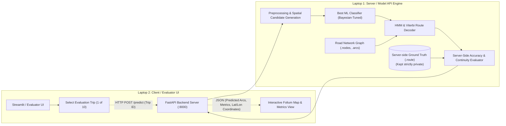

# PathSnap: Distributed Map-Matching & Route Reconstruction

> **PES University — Department of Computer Science and Engineering**  
> **Course:** UE24CS352A: Machine Learning  
> **Challenge:** PathSnap — End-to-End Distributed Map-Matching & Sequence Route Reconstruction

---

## 1. Project Overview

GPS tracking systems often suffer from measurement noise caused by urban canyons, multipath reflections, receiver clock errors, and low or irregular sampling frequencies. As a consequence, raw GPS points frequently appear to jump across buildings, drift into adjacent parallel streets, or exhibit unnatural velocity spikes.

**PathSnap** is an end-to-end, distributed machine learning system engineered to reconstruct realistic, topologically valid vehicle trajectories by matching noisy GPS observations to an underlying road network graph. 

### Key System Capabilities
- **Geospatial Preprocessing & Candidate Generation:** Projects WGS84 angular coordinates into Cartesian planar coordinates (or uses geodesic distance calculations), identifies top road segment candidates within spatial search radii using spatial indices (k-d trees / R-trees).
- **Candidate Classification (5+ Models):** Formulates candidate scoring using engineered spatial, heading, and distance features, rigorously benchmarking at least 5 distinct algorithm families (e.g., Logistic Regression/Naive Bayes, k-NN, Random Forest, XGBoost/LightGBM, Multi-Layer Perceptron).
- **Bayesian Hyperparameter Optimization:** Uses Optuna to perform Bayesian optimization with group-aware cross-validation across training trips.
- **Hidden Markov Model (HMM) & Viterbi Decoding:** Reconstructs continuous, topologically consistent routes by computing emission probabilities (from classifier confidence & spatial distances) and transition probabilities (from shortest road network path lengths vs. observed GPS displacements).
- **Two-Laptop Distributed Deployment:** Deploys a decoupled architecture where **Laptop 1** hosts the FastAPI prediction server and HMM engine, and **Laptop 2** runs the evaluator-facing UI with interactive Folium maps.

---

## 2. System Architecture

PathSnap follows a strict distributed two-laptop deployment architecture as mandated by the evaluation guidelines:



---

## 3. Repository Directory Structure

```text
ML_HACKATHON/
├── data/
│   ├── raw/
│   │   ├── train/                 # 80 training trips (.track, .nodes, .arcs, .route)
│   │   ├── student_test/          # 10 student testing trips (.track, .nodes, .arcs, .route)
│   │   └── evaluator_test/        # 10 evaluator testing trips (.track, .nodes, .arcs)
│   ├── processed/                 # Cached candidate sets, extracted feature matrices
│   └── README.md                  # Dataset notes & schema documentation
├── notebooks/
│   ├── 01_eda_and_exploration.ipynb        # Exploratory Data Analysis & GPS analysis
│   ├── 02_candidate_generation.ipynb       # Spatial candidate arc selection
│   ├── 03_model_experimentation.ipynb      # Training & comparing 5+ algorithm families
│   ├── 04_bayesian_optimization.ipynb      # Optuna Bayesian hyperparameter search
│   └── 05_hmm_viterbi_evaluation.ipynb     # HMM Viterbi decoding & route continuity
├── src/
│   ├── __init__.py
│   ├── config.py                  # Global configurations, paths, hyperparameter presets
│   ├── data/
│   │   ├── __init__.py
│   │   ├── loader.py              # Parsing .track, .nodes, .arcs, and .route files
│   │   └── preprocessor.py        # Coordinate projections, noise filtering, time-gap handling
│   ├── features/
│   │   ├── __init__.py
│   │   ├── candidate.py           # Spatial candidate generation using KDTree / spatial indexing
│   │   └── extractor.py           # Feature engineering (perpendicular dist, heading delta, etc.)
│   ├── models/
│   │   ├── __init__.py
│   │   ├── train.py               # Multi-model training and evaluation pipeline
│   │   ├── evaluate.py            # Metrics: Top-1 Acc, Macro F1, Log Loss, Miss Rate
│   │   └── bayesian_opt.py        # Bayesian optimization scripts (Optuna)
│   ├── reconstruction/
│   │   ├── __init__.py
│   │   ├── graph.py               # Road network graph builder (NetworkX)
│   │   ├── hmm.py                 # Emission and transition probability models
│   │   └── viterbi.py             # Viterbi sequential decoder for route continuity
│   ├── visualization/
│   │   ├── __init__.py
│   │   └── map_plotter.py         # Folium map generation (raw GPS, ground truth, predicted)
│   └── api/
│       ├── __init__.py
│       ├── schemas.py             # Pydantic request & response models
│       └── main.py                # FastAPI endpoints (Laptop 1 server)
├── ui/
│   ├── __init__.py
│   ├── app.py                     # Streamlit evaluator interface (Laptop 2 client)
│   └── README.md                  # UI setup instructions
├── artifacts/
│   ├── models/                    # Saved model binaries (.joblib / .pkl)
│   ├── scalers/                   # Saved feature scalers and transformers
│   ├── maps/                      # Exported interactive Folium HTML maps
│   └── results/                   # Experiment comparison tables, CSV logs, Optuna study logs
├── reports/
│   └── figures/                   # Confusion matrices, loss curves, Folium screenshots for PDF
├── tests/
│   ├── test_data_loader.py        # Unit tests for dataset parsers
│   ├── test_candidate.py          # Unit tests for candidate extraction
│   └── test_viterbi.py            # Unit tests for Viterbi recurrence
├── .gitignore
├── requirements.txt
└── README.md
```

---

## 4. Dataset Specification

The raw data is organized by trip, each containing whitespace-separated files without headers:

| File Extension | Content Description | Format & Structure |
| :--- | :--- | :--- |
| `.track` | GPS observations for a trajectory | 3 columns: `longitude`, `latitude`, `timestamp` (seconds). Nominally 1 Hz (~97% exactly 1s apart). |
| `.nodes` | Geographical road network nodes | 2 columns: `longitude`, `latitude`. 0-based row index serves as `node_id`. |
| `.arcs` | Road segments connecting nodes | 2 columns: `from_node_id`, `to_node_id`. 0-based row index serves as `arc_id`. |
| `.route` | Ground-truth reference route | 1 integer column: Chronological sequence of true `arc_id` values traversed. |

### Dataset Partitions & Partitioning Rules
- **Training (80 trips):** Model exploration, feature engineering, group-aware cross-validation, and Bayesian hyperparameter tuning.
- **Student Testing (10 trips):** Development-stage comparative evaluation between untuned/tuned models and classifier vs. HMM.
- **Evaluator Testing (10 trips):** Final demonstration evaluation only. Strictly isolated:
  - No evaluator-test trip is accessed during training or hyperparameter search.
  - Ground-truth `.route` files remain on Laptop 1 (server-side only) and are never exposed to the client UI.

---

## 5. Machine Learning & Route Reconstruction Pipeline

### 1. Data Exploration & Feature Engineering
- **Geodesic / UTM Projection:** Angular coordinate pairs `(lon, lat)` are projected to local UTM coordinates for accurate Euclidean meter calculations, or computed via Haversine/Vincenty formulas.
- **Candidate Arc Selection:** For each GPS point, candidates are extracted within a radius $R$ (e.g., 30–50 meters) using spatial indexing.
- **Engineered Features:**
  - Perpendicular distance from GPS observation to candidate road segment.
  - Heading differential between vehicle trajectory heading ($\Delta \theta_{GPS}$) and road arc orientation ($\theta_{arc}$).
  - Projection factor $t \in [0, 1]$ (position along the arc segment).
  - Estimated velocity and acceleration consistency.
  - Road network connectivity / degree of adjacent nodes.

### 2. Multi-Model Benchmark (5 Algorithm Families)
In accordance with hackathon requirements, at least 5 distinct algorithms are trained and compared using Group-K-Fold cross-validation (grouped by `trip_id`):
1. **Linear / Probabilistic:** Logistic Regression (L2 regularized) or Gaussian Naive Bayes.
2. **Instance-Based:** Distance-Weighted k-Nearest Neighbors ($k$-NN).
3. **Tree-Based / Ensembles:** Random Forest Classifier.
4. **Gradient Boosting:** LightGBM / XGBoost.
5. **Neural Networks:** Multi-Layer Perceptron (MLP) with Dropout and Batch Normalization.

### 3. Bayesian Hyperparameter Optimization
- Optuna Bayesian optimization performs exploration over parameter spaces (e.g., tree depth, learning rate, regularization weights, number of estimators).
- Metric optimized: Group Cross-Validation Macro F1-score across the 80 training trips.

### 4. HMM & Viterbi Sequence Decoding
Pointwise classification predictions alone often result in broken routes due to GPS noise. The HMM resolves this:
- **Hidden States:** The set of candidate road segments ($arc_i$) for each observation time step $t$.
- **Emission Probability $P(O_t \mid S_t)$:** Derived from the classifier output probability calibrated with spatial observation error (Gaussian noise model $d(O_t, S_t) \sim \mathcal{N}(0, \sigma^2)$).
- **Transition Probability $P(S_{t+1} \mid S_t)$:** Derived from road-network shortest routing distance $d_{road}(S_t, S_{t+1})$ compared with great-circle GPS displacement $d_{euclid}(O_t, O_{t+1})$:
  $$P(S_{t+1} \mid S_t) \propto \exp\left(-\frac{|d_{road} - d_{euclid}|}{\beta}\right)$$
- **Viterbi Decoding:** Dynamically decodes the maximum a posteriori (MAP) sequence of topologically connected road segments over the entire trajectory.

---

## 6. Setup & Installation

### Prerequisites
- Python 3.10 or 3.11
- Git

### 1. Clone Repository & Setup Virtual Environment
```bash
git clone https://github.com/<your-username>/ML_HACKATHON.git
cd ML_HACKATHON

# Create virtual environment
python -m venv venv

# Activate virtual environment
# Windows PowerShell:
.\venv\Scripts\Activate.ps1
# Linux/macOS:
# source venv/bin/activate

# Upgrade pip and install dependencies
pip install --upgrade pip
pip install -r requirements.txt
```

---

## 7. Execution & Deployment Guide

### Running Experiments & Pipelines
1. **Run Exploratory Data Analysis & Feature Extraction:**
   ```bash
   python -m src.data.preprocessor
   python -m src.features.extractor
   ```
2. **Train and Compare Models:**
   ```bash
   python -m src.models.train
   ```
3. **Run Bayesian Optimization (Optuna):**
   ```bash
   python -m src.models.bayesian_opt
   ```
4. **Evaluate HMM & Generate Folium Visualizations:**
   ```bash
   python -m src.reconstruction.viterbi
   ```

---

### Two-Laptop Setup for Final Evaluation

#### Laptop 1: Model & API Server
1. Ensure Laptop 1 and Laptop 2 are on the same local network (e.g., Wi-Fi or hotspot).
2. Find Laptop 1's local IP address:
   ```powershell
   ipconfig   # Look for IPv4 Address (e.g., 192.168.1.50)
   ```
3. Start the FastAPI backend server bound to all network interfaces:
   ```bash
   uvicorn src.api.main:app --host 0.0.0.0 --port 8000 --reload
   ```
4. Verify backend health check by visiting `http://localhost:8000/health` or `http://<laptop-1-ip>:8000/docs`.

#### Laptop 2: Evaluator User Interface
1. Clone the repository and install dependencies on Laptop 2.
2. Set the API host environment variable or configure it directly in the UI:
   ```bash
   # Set API endpoint to Laptop 1's IP
   $env:API_URL="http://192.168.1.50:8000"   # Windows PowerShell
   # export API_URL="http://192.168.1.50:8000" # Linux/macOS
   ```
3. Launch the Streamlit interface:
   ```bash
   streamlit run ui/app.py
   ```
4. In the UI:
   - Select any of the 10 evaluation trips from the dropdown.
   - Click **"Run Route Reconstruction"**.
   - Inspect the interactive Folium map comparing raw GPS, ground-truth route, and predicted route, alongside observation-level Top-1 Accuracy, Macro F1, and Route Continuity metrics.

---

## 8. Evaluation Metrics

The system reports the following evaluation metrics:
- **Observation-level Top-1 Accuracy:** Proportion of GPS observations correctly mapped to the exact reference arc.
- **Macro F1-score:** Unweighted mean of F1 scores across candidate classes.
- **Log Loss:** Cross-entropy loss reflecting prediction confidence calibration.
- **Candidate Miss Rate:** Percentage of time steps where the true reference arc was not present in the candidate set.
- **Route Continuity (%):** Fraction of consecutive predicted road segments that form a valid, connected path in the road network graph.
- **Inference Time (ms):** Total latency to process and decode an entire trajectory.

---

## 9. Academic Integrity & Anti-Leakage Compliance

This repository complies strictly with PES University's academic integrity policies:
- **Strict Data Partitioning:** Evaluator testing data is never touched during feature engineering, model training, or hyperparameter selection.
- **Server-Side Evaluation:** Evaluator ground-truth `.route` files remain strictly server-side on Laptop 1. The client UI receives only the predicted sequence and computed evaluation scores.
- **No Hardcoded Predictions:** All route predictions are computed dynamically at runtime through the trained model and Viterbi decoder. Live API request/response logs are displayed on Laptop 1's console for evaluator inspection.
